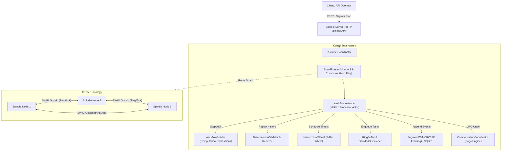

# Spindle Kernel Architecture & System Topography

Spindle is a deterministic, durable execution kernel and distributed saga orchestrator implemented in pure F# on .NET 9. It provides reliable, fault-tolerant execution of stateful workflows across untrusted network topologies, node crashes, and arbitrary network partitions.

---

## 1. High-Level System Architecture

The following diagram illustrates the layered subsystems and data flow within Spindle:

---

## 2. Core Subsystems & Components

### 2.1 Core Domain & Cryptographic Integrity (`Spindle.Core`)

* **Domain Primitives**: Strongly typed value objects (`WorkflowId`, `RunId`, `ActivityId`, `TimerId`, `ShardId`, `TenantId`, `SequenceNumber`, `FencingToken`).
* **Timestamp & Duration Abstraction**: Deterministic virtual time tracking with 100-nanosecond tick resolution (`Timestamp`, `Duration`).
* **Murmur3 32-Bit Hash**: Optimized native hash generator for partition sharding and consistent hashing.
* **Castagnoli CRC32C (`0x82F63B78`)**: Hardware-accelerated polynomial lookup table for frame verification and torn-write detection.
* **Codecs & Schemas**: Zero-allocation JSON and binary serializers supporting F# discriminated unions.

### 2.2 Deterministic Workflow Engine (`Spindle.Engine`)

* **Computation Expression Syntax**: Clean monadic syntax (`workflow { ... }`) for composing activities, delays, and compensations.
* **Determinism Replay Validator**: Prevents non-deterministic code execution by verifying that replayed commands match journaled events.
* **Actor Instance Container**: Isolated `MailboxProcessor` actors managing workflow instance state without lock contention.
* **Pure Functional State Machine**: Reducer mapping `(WorkflowInstanceSnapshot, JournalRecord) -> WorkflowInstanceSnapshot`.

### 2.3 Hierarchical Timing Wheel (`Spindle.Timers`)

* **5-Tier Wheel Architecture**: Based on the Varghese and Lauck (1987) algorithm.
* **Bitmask Spans**:
  * Level 0: 256 slots (8 bits, 0 to 255 ticks)
  * Level 1: 64 slots (6 bits, up to 16,384 ticks)
  * Level 2: 64 slots (6 bits, up to 1,048,576 ticks)
  * Level 3: 64 slots (6 bits, up to 67,108,864 ticks)
  * Level 4: 64 slots (6 bits, overflow tier)
* **Performance**: $O(1)$ timer scheduling and $O(1)$ amortized tick execution.

### 2.4 Resilient Distributed Queue (`Spindle.Queue`)

* **Lock-Free MPSC Ring Buffer**: Multi-Producer Single-Consumer queue using memory barriers and atomic compare-and-swap operations.
* **Priority Queue**: Binary min-heap with deterministic FIFO tie-breaking for equal priority tasks.
* **Retry Evaluator**: Implements Full Jitter and Decorrelated Jitter algorithms to eliminate thundering herd problems.
* **Lease Fencing Manager**: Enforces monotonically increasing fencing tokens to prevent split-brain dual writers.

### 2.5 Storage Engines & Write-Ahead Log (`Spindle.Storage`)

* **Segmented WAL**: Append-only log with CRC32C header and footer checksums. Automatically truncates torn writes on recovery.
* **SQLite Storage Engine**: Persistent ACID storage utilizing transactions for atomic multi-event commits.
* **In-Memory Storage**: Concurrent dictionary-backed storage for high-speed simulation and unit tests.

### 2.6 Distributed Sagas & Compensation Coordinator (`Spindle.Sagas`)

* **LIFO Compensation Stack**: Backward rollback coordinator executing inverse actions in exact reverse order of forward operations.
* **Dual-Phase Execution**: Isolates forward business actions from compensation barriers.
* **Production Workflows**: Includes E-Commerce Order Fulfillment, Financial Multi-Leg Settlement, and Cloud Infrastructure Provisioning.

### 2.7 SWIM Gossip & Cluster Routing (`Spindle.Cluster`)

* **SWIM Failure Detector**: Scalable Weak-Consistency Infection-Style Process Group Membership Protocol with direct Ping, indirect Ping-Req, and Suspect state tracking.
* **Consistent Hash Ring**: Implements virtual nodes (vnodes) to guarantee uniform distribution across cluster nodes.
* **Shard Router**: Deterministically maps workflow IDs to shard slots and resolving owner nodes.

### 2.8 Discrete-Event Chaos Simulator (`Spindle.Simulation`)

* **Xorshift128+ PRNG**: High-performance deterministic pseudorandom generator initialized from explicit integer seeds.
* **Adversarial Fault Models**: Simulates packet drops, symmetric network partitions, node crashes, and restarts under a virtual clock.
