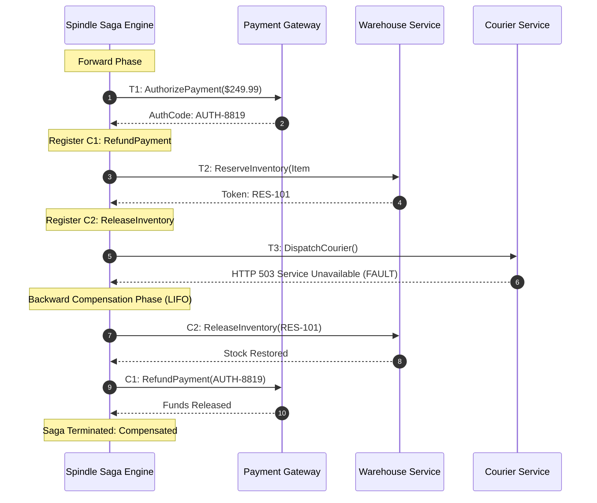

# Distributed Sagas & LIFO Compensation in Spindle

Distributed systems spanning disparate databases, external payment processors, and cloud providers cannot reliably use two-phase commit (2PC). This document details how Spindle implements the Saga Pattern with automated, durable Last-In-First-Out (LIFO) compensation.

---

## 1. Why Two-Phase Commit (2PC) Breaks at Scale

Traditional ACID transactions rely on 2PC protocols:
* **Blocking Coordinator**: If the transaction coordinator crashes during the prepare phase, participating resource managers remain locked indefinitely.
* **Lock Contention**: Database rows remain exclusively locked throughout the duration of network round-trips to external third-party APIs.
* **Incompatibility with External APIs**: Stripe, FedEx, AWS, or Twilio cannot participate in XA/2PC transactions.

---

## 2. The Saga Pattern (Garcia-Molina & Salem)

A Saga is a sequence of local transactions $T_1, T_2, \dots, T_n$ where each transaction updates state within a single service. For every transaction $T_i$, there exists a semantically defined compensating transaction $C_i$:



---

## 3. Declarative Compensation in Spindle

In Spindle, compensations are declared inline within `workflow` computation expressions:

```fsharp
let orderFulfillmentWorkflow (order: OrderRequest) : Workflow<OrderFulfillmentResult> = workflow {
    // Step 1: Authorize customer card
    let! payment = Workflow.activity "AuthorizePayment" order None

    // Register compensation immediately following forward success
    do! Workflow.compensate (fun () -> workflow {
        do! Workflow.activity "RefundPayment" payment None
    })

    // Step 2: Reserve inventory
    let! inv = Workflow.activity "ReserveInventory" order None

    // Register inventory rollback
    do! Workflow.compensate (fun () -> workflow {
        do! Workflow.activity "ReleaseInventory" inv None
    })

    // Step 3: Courier dispatch (may fail)
    let! courier = Workflow.activity "DispatchCourier" order None

    return { ... }
}
```

### Key Guarantees:
1. **LIFO Inversion**: If Step 3 fails, the compensation coordinator unwinds the stack in reverse order: executing `ReleaseInventory` first, followed by `RefundPayment`.
2. **Crash Resilience**: Compensation closures and their captured inputs are serialized and committed to the durable event journal. If the orchestrator process crashes during compensation, the replacement node recovers the stack from the journal and resumes the rollback sequence without dropping or re-ordering compensations.
